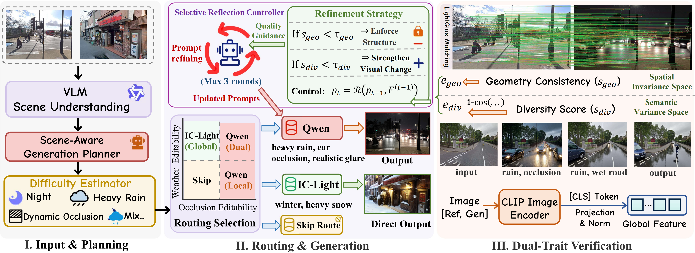

# AdaptVPR：Qwen 数据增广

本工作区的主流程是 **GSV-Cities 困难源图筛选 → Qwen 天气编辑 → 结构与天气审核 → SALAD 训练与评估**。面向单台 48 GB 显卡、32 GB 内存，生成与训练分阶段运行。天气域为 night、snow、fog、rain。

## 从这里开始

- [Qwen 工作流](experiments/qwen_curriculum/README.md)：全部 23 城市的分批生成、审核、恢复及训练命令。
- [SALAD 工作流](../salad/docs/workflow.md)：真实图与合成图的训练、评估和对照。
- [可靠性 OT](../salad/docs/reliability_v2.md)：可选的 patch 可靠性模块。
- [依赖与资源配置](docs/EXTERNAL_COMPONENTS.md)：Qwen、VisMatch、CLIP 的安装和显存设置。
- [生成 API](docs/API_CONTRACTS.md)：服务健康检查、源图比例画布及请求协议。

## 目录职责

| 路径 | 用途 |
|---|---|
| `experiments/qwen_curriculum/` | 23 城市生成、恢复、原始 SALAD 微调及六域 SVOX 测试 |
| `adapters/lightx2v_qwen_image_edit.py` | Qwen HTTP 服务 |
| `generation/qwen_disk_weights.py`、`qwen_resident.py` | 低内存 BF16 权重准备和 GPU 常驻缓存 |
| `verification/` | 结构匹配与 CLIP 图像特征 |
| `generation/`、`prompts/`、`run.py` | 原论文路线规划、提示反思与 Global/Local/Dual 生成入口 |
| `preprocessing/`、`scripts/build_manifest.py` | 原路线生成结果的训练清单导出 |
| `configs/`、`scripts/` | 公共配置、依赖准备、服务启动 |
| `tests/` | 单元测试与可重跑的十图 demo 输入 |
| `experiments/generation_diagnosis/` | 生成结果诊断及当前审核使用的匹配统计 |

现行服务启动器、环境预检及公共配置只使用 Qwen。生成图片统一存放在 `outputs/qwen_curriculum/images/`，计划、账本、恢复状态和训练输出位于 `outputs/qwen_curriculum/state/`。

## 安装与服务

在本工作区的 AdaptVPR 目录中执行：

```bash
pip install -r requirements.txt
pip install -r adapters/requirements.txt
cp configs/default.env.example .env
```

根据 [依赖说明](docs/EXTERNAL_COMPONENTS.md) 配置现有 LightX2V、模型权重、VisMatch 和 CLIP。数据与权重由本地路径提供。主流程使用固定天气提示，不需要规划器服务；原论文 `run.py` 规划与反思模式另需 Qwen3-VL 端点。

```bash
bash scripts/start_generation_services.sh --wait
curl --noproxy '*' http://127.0.0.1:8001/health
```

持久化 Qwen 服务安装见 [systemd 配置](configs/systemd/README.md)。修改配置后仅重启已选用的服务管理方式，避免重复加载生成模型。

## 原论文路线入口

`run.py` 保留路线规划、Global/Local/Dual 提示与双指标验证。三个生成路线均调用 Qwen。其路线配额和验收门限独立于当前困难源图工作流，详见 [调度规则](docs/SCHEDULER.md)。十图 demo 可以检查该入口：

```bash
python tests/run_demo_10.py --gsvcities-root /path/to/Gsvcities \
  --output /path/to/demo_10 --check-only
python tests/run_demo_10.py --gsvcities-root /path/to/Gsvcities \
  --output /path/to/demo_10 --strict --resume
```

输入清单和官方提示保留在 `tests/demo_10*`；生成展示图由上述命令重新生成。

## 方法来源与许可

本目录基于 [AdaptVPR: Route-Aware Hard Positive Generation for Robust Visual Place Recognition](https://arxiv.org/abs/2609.04369) 的公开实现，工作区增加了 Qwen 困难源图工作流和 SALAD 对照实验。原始论文方法图保留如下：



原始 GSV-Cities 图片和生成训练图不随源码分发；公开 AdaptCities 提示、标注与元数据见 [Hugging Face](https://huggingface.co/datasets/shunpeng/AdaptCities)。许可见 [LICENSE](LICENSE)。

This project builds on [Qwen3-VL-4B-Instruct](https://huggingface.co/Qwen/Qwen3-VL-4B-Instruct), [IC-Light](https://github.com/lllyasviel/IC-Light), [Qwen-LightX2V](https://github.com/ModelTC/LightX2V), [VisMatch](https://github.com/gmberton/vismatch), [CLIP](https://huggingface.co/openai/clip-vit-base-patch32), and [GSV-Cities](https://github.com/amaralibey/gsv-cities).

We also thank the authors of [BoQ](https://github.com/amaralibey/Bag-of-Queries), [ImAge](https://github.com/buptzjy/ImAge), [SALAD](https://github.com/serizba/salad), and [EDTFormer](https://github.com/buptzjy/EDTFormer) for their public implementations.

引用原方法：

```bibtex
@article{chen2026adaptvpr,
  title   = {AdaptVPR: Route-Aware Hard Positive Generation for Robust Visual Place Recognition},
  author  = {Chen, Shunpeng and Zhang, Jingyi and Wang, Changwei and Xu, Shengpeng and Song, Yukun and Pei, Xingtian and Lin, Jinzhou and Guo, Li and Xu, Shibiao},
  journal = {arXiv preprint arXiv:2609.04369},
  year    = {2026}
}
```
