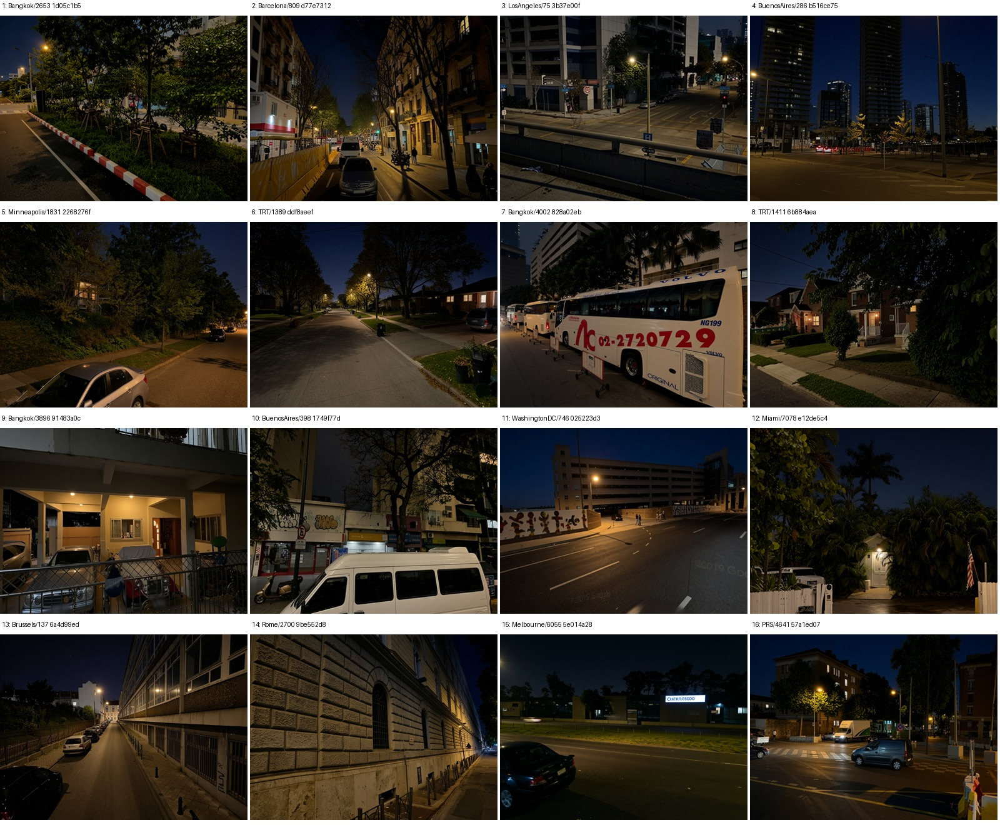
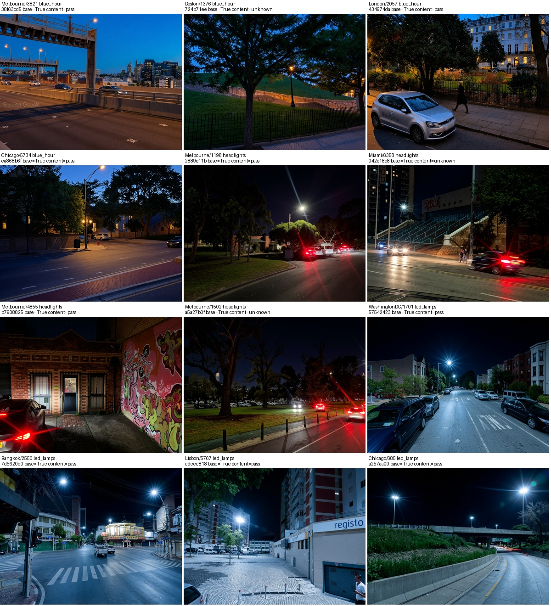
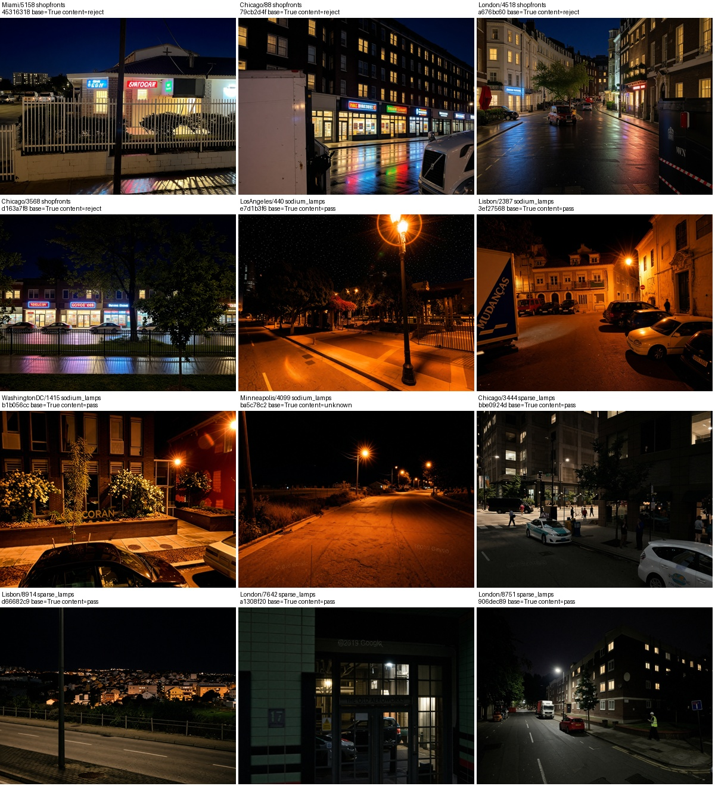
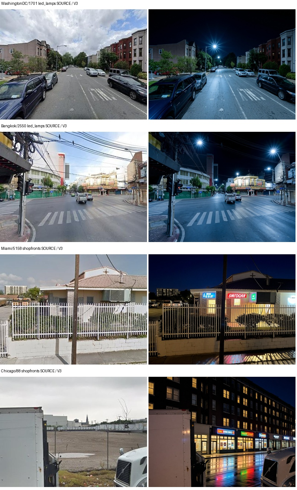
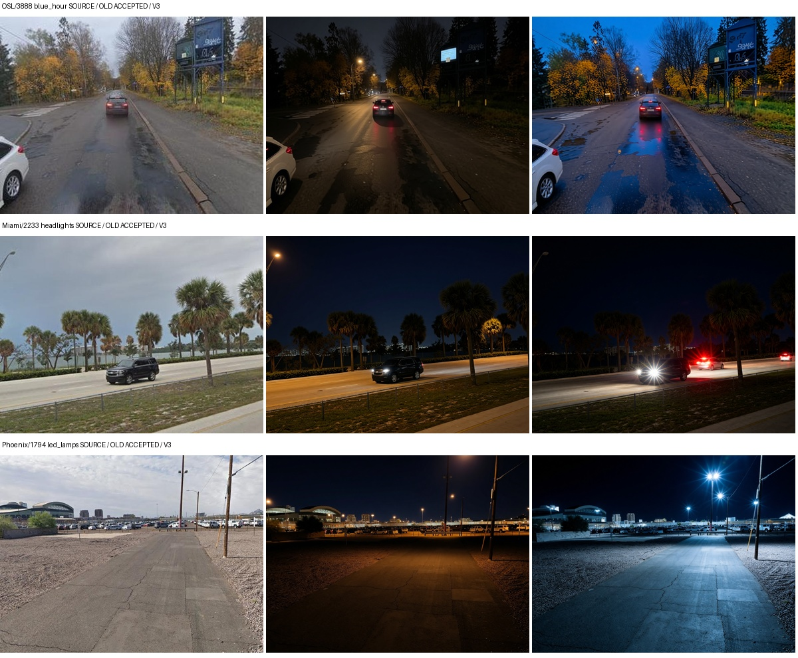
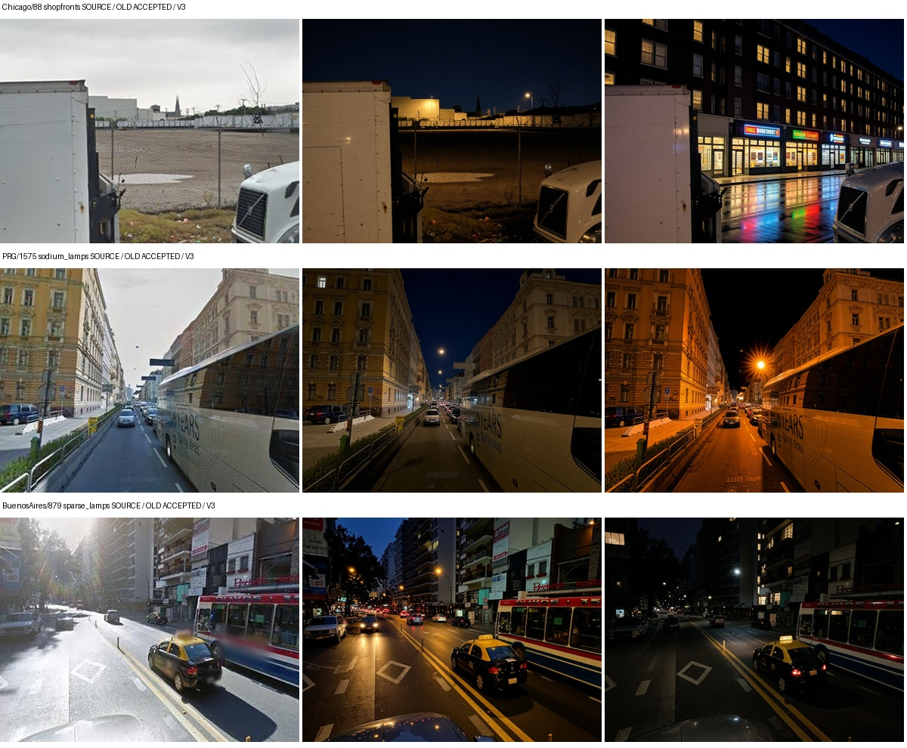
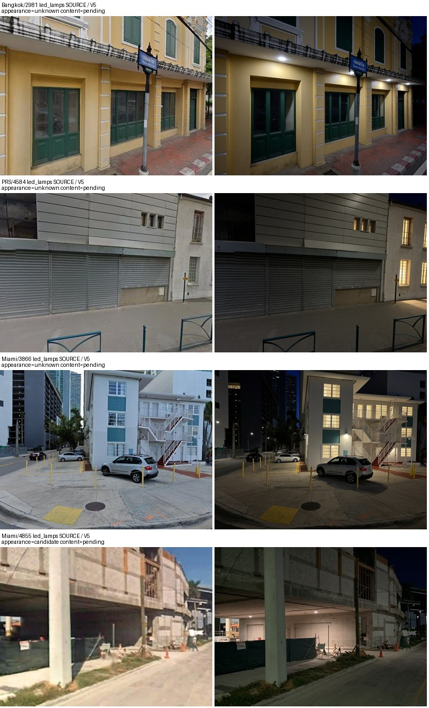
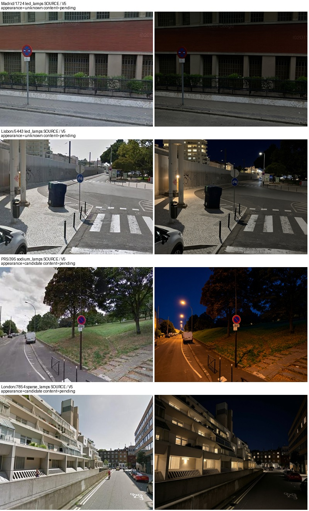

# 三组夜景生成数据比较：旧 accepted、weather_v3 与 weather_v5_pilot

核查日期：2026-10-26（北京时间）。本文面向本项目的 **GSV-Cities 天气增广 → DINOv2 + SALAD 地点识别**，综合实际图片、冻结配置、生成账本和已有诊断；没有运行新生成、训练或模型推理。

## 1. 我的判断与使用建议

**如果问“哪组夜景效果更稳定”，我仍倾向于旧 accepted 库；如果问“哪组更值得用于下一轮夜间鲁棒性实验”，我优先考虑内容复查通过的 v3 子集。v5 的约束方向值得继续验证，但当前 8 张试验图不足以替代前两组。**

这里的“优先考虑”是研究方案建议，并不表示已经测出了三组之间的 Recall 优劣。

| 判断维度 | 旧 accepted/night | weather_v3/night | weather_v5_pilot/night |
|---|---|---|---|
| 抽样夜景观感 | 较稳定，常见暖色路灯、暗天空、可辨认街景 | 光照差异更强，冷光、钠灯、车灯、蓝调时刻差别明显；部分效果过度 | 有合理局部照明，也有主要靠压暗实现的样本 |
| 外观多样性 | 单一提示词，抽样中风格相近 | 六种变体，三者中有最明确的多样化设计与已有难度证据 | 提示词定义四种严格夜间变体，但现有 8 张只覆盖三种，且 6 张是 LED |
| 地点内容保留 | 大体结构常保留，仍会修改局部或补出照明 | 个别图发生显著幻觉，尤其 shopfronts；必须筛选 | 保留要求最明确，但模型仍会改动门窗、照明等局部 |
| 已有训练难度证据 | 有较大样本的难度探针，但夜间位移偏弱 | 小样本 pilot 位移明显增强；不能外推到整个目录 | 尚无可用于三组排名的 SALAD 难度/训练收益证据 |
| 当前合理角色 | 保守增广对照、历史基线 | **内容复查后的困难正样本候选池** | 整幅场景夜间重照明的探索性试验 |

上一轮回答只比较旧库与 v5，推荐旧库。加入 v3 及已有内容复查结果后，建议更具体：**保留旧库做对照，优先研究筛选后的 v3，不直接使用 v3 整个目录，也不因为 v5 版本更新就默认它更好。**

## 2. 先分清三个目录实际包含什么

下面的数字来自核查时的本地文件与账本，是一个固定快照；后续生成可能改变数量。

| 项目 | 旧库 | v3 | v5 |
|---|---|---|---|
| 本次指定目录 | `outputs/qwen_curriculum/images/accepted/night/` | `outputs/weather_v3/night/` | `outputs/weather_v5_pilot/night/` |
| 目录内 night PNG | **7,719** | **3,853** | **8** |
| 地点数 | 6,842 | 3,853 | 8 |
| 城市数 | 23 | 23 | 6 |
| 是否已按原自动规则筛选 | 是，accepted 为通过入口链接 | 否，目录包含全部已生成 night 图 | 否，包含全部 pilot 图 |
| 基础几何/天气审核 | 旧结果中 night 共 10,518 张，7,719 张通过 | 3,148 张通过、705 张未通过 | 8 张全部通过 |
| 更后续的检查 | 不能用 accepted 名称推定已完成当前内容审核 | 已有 v4.2 内容复查快照 | 区域夜景检查 3 张 candidate、5 张 unknown；独立内容审核待完成 |

**第一项是筛选后的目录，第二、三项是生成目录，不能直接比较文件夹平均观感或审核通过率来判断生成器优劣。** 三者的规则、源图和样本构成也不同。

v3 的 `state/summary.json` 中 `saved=3858` 是所有域合计，night 为 3,853；另有 2 张 snow、2 张 rain、1 张 rainy_night。下文比较夜景时均使用 night 数字。

旧库不是“一地点一图”，v3 当前计划是一地点一图。把它们放入训练时，图片数、地点覆盖与实际曝光都要分别统计。

来源：[旧图片元数据](../outputs/qwen_curriculum/images/metadata.jsonl)、[旧结果](../outputs/qwen_curriculum/state/results.jsonl)、[v3 汇总](../outputs/weather_v3/state/summary.json)、[v5 汇总](../outputs/weather_v5_pilot/state/summary.json)。

## 3. 三者的生成目标有什么不同

### 3.1 旧库：用单一保守模板改变夜间氛围

核对旧结果中的 10,518 条 night 记录，使用的是同一条提示词。核心要求是保留建筑、标志、车辆和视角，施加较暗街灯与较低环境亮度，避免结构变化、模糊和形变。

这种方案的优点是目标简单，容易得到可辨认的夜间街景；抽样里经常出现暖黄灯光、暗蓝或黑天空，建筑和道路保持清楚。

它的局限是：光照变化类型有限，画面容易呈现同一类“清晰暖灯夜景”；真实夜间检索中的色温差异、眩光、局部过曝、噪声、细节损失等未必充分出现。保守提示词也不保证灯具、文字和细节绝对不被重画。

来源：[旧结果中的实际 prompt](../outputs/qwen_curriculum/state/results.jsonl)、[保守夜景模板](../AdaptVPR/prompts/rules.py)。

### 3.2 v3：主动增加光照机制与成像差异

v3 使用 `qwen_weather_bank_v3.1`，不再只要求“变暗”，而是分别指定六种夜间外观：

| 变体 | 想提供的变化 | 对 VPR 的潜在帮助 | 需要注意的问题 |
|---|---|---|---|
| `sodium_lamps` | 暖橙钠灯、明暗光池、灯晕与颗粒 | 降低对日间色彩和均匀照明的依赖 | 可能全图染橙、灯晕过强或补出灯源 |
| `led_lamps` | 冷白/偏蓝 LED、亮灯头、强明暗反差 | 覆盖冷光夜景和局部高亮 | 可能过度偏蓝、路面过亮或出现过强星芒 |
| `shopfronts` | 发光橱窗、招牌、窗户与路面反射 | 原意是增加商业街夜间变化 | **容易新增商铺、文字和建筑；现有内容策略整类排除** |
| `sparse_lamps` | 稀疏照明、大暗区、弱可见轮廓 | 提供低照度但仍有地点证据的正样本 | 深暗处可能缺失辨识信息；局部内容仍需检查 |
| `headlights` | 车灯、尾灯、眩光和轻微运动模糊 | 覆盖交通夜景的强局部光照 | 可能新增车辆、改变交通状态或遮挡地点线索 |
| `blue_hour` | 日落后蓝色天空、较低环境光与暖灯 | 覆盖黄昏到夜间的过渡 | **不等同于完全入夜，严格 night 实验应单列** |

这些是提示词的目标，不能据此断言每张图都实现了相应的真实相机效果。

v3 还改变了源图组织：从符合画质和 SALAD 可靠度要求的地点选源图，每地点安排一张，而非继续只沿用旧困难源图池。因而三者差异不只来自提示词。

来源：[v3 提示词代码](../AdaptVPR/experiments/qwen_curriculum/prompt_bank.py)、[v3 计划说明](../AdaptVPR/experiments/qwen_curriculum/WEATHER_V3.md)。

### 3.3 v5：强调整幅场景重新照明与已有物体约束

v5 基于 v4 的内容约束进一步处理“黑天空配白天墙面/道路”的问题：

- 墙面、道路、人行道和植被都要移除日间照明，不依赖天空是否可见。
- 只允许源图中已有灯具、窗户和车辆灯发光；禁止新增/删除物体、重写文字。
- 没有可见光源时使用弱夜间环境光，允许暗处细节自然不可见。
- 明确要求干路面，避免把普通 night 自动变成湿路反光夜景。
- 严格 night 只保留 LED、钠灯、稀疏照明、已有车灯四种变体，移除 blue hour 和 shopfronts。

这套约束更贴近“同一地点、同一物理场景、只改变照明”的增广目标。但指令更完整不代表生成结果一定更忠实。现有 8 张中仍有内容改动，也有只做了较大亮度变化的样本。

三者都基于本项目 Qwen-Image-Edit-2511 / Lightning 4-step BF16 路线；v5 不是换成了一个更强的新模型。差异主要涉及提示词、源图选择、审核和样本构成，不能把表现归因于版本号。

来源：[v5 提示词](../AdaptVPR/experiments/qwen_curriculum/prompt_bank_v5.py)、[v5 实验说明](../salad/docs/night_generation_v5.md)、[v3 冻结服务配置](../outputs/weather_v3/state/plan_config.json)。

## 4. 审核规则不同，“通过”不表示同一种质量

| 检查 | 旧库原规则 | v3 基础规则 | v5 当前规则 |
|---|---|---|---|
| 几何内点率 `s_geo` 下限 | 0.78 | 0.70 | 沿用 v3 基础几何规则 |
| 最少匹配点 | 16 | 16 | 16 |
| 单应性网格位移中位数上限 | 16 px | 32 px | 沿用 v3 基础几何规则 |
| 位移的坐标尺度 | 匹配器 512×512 坐标 | 同左 | 同左 |
| 天气检查 | 全图 CLIP 夜间相对晴天的差异及相对源图变化 | 更新了文本集合，支持多域 | 基础检查之外，再检查完整图、中心和下部的夜间解释 |
| 是否直接证明内容没有幻觉 | 否 | 否 | 否，仍需独立内容审核 |

`s_geo` 是匹配点中的几何内点比例，不是“场景保真度百分比”。即使大部分道路和建筑仍能匹配，局部新增一个商店或车辆也可能漏过；32 px 上限也不等于允许原始 400×300 图任意移动 32 px。

v3 放宽几何门槛，是为了减少对照明变化较强、略有重构图样本的误拒，但也增加了后续局部内容筛选的重要性。其原清单中的 `eligible_for_training=true` 表示满足当时规则，不能自动替代后来的内容审核。

v5 的区域检查比较“夜间、晴天、阴天、白天压暗假夜景”的文本解释，任何一个裁剪的夜间解释没有胜出就记为 unknown。三个区域都通过也只是 candidate；这是未校准的 CLIP 排名检查，不是夜景真实性概率。

来源：[旧审核实现](../AdaptVPR/experiments/qwen_curriculum/quality.py)、[v3 审核实现](../AdaptVPR/experiments/qwen_curriculum/quality_v3.py)、[v5 区域检查](../AdaptVPR/experiments/qwen_curriculum/night_appearance_v5.py)。

## 5. 实际看图：v3 更有变化，也更容易改写地点

### 5.1 本次看了哪些图

沿用上一轮旧库随机 32 张和 v5 全部 8 张的观察；本轮对 v3 每种变体固定随机抽取 4 张基础审核通过图、2 张未通过图，共 **36 张**。另检查 v3 的 12 组源图对照，以及旧库/v3 的 6 组同源对照。

抽样 seed 为 `20261026`，先按 `sample_id` 排序。v3 是按变体和基础审核状态分层抽样，不能用这 36 张估计整个目录的缺陷率。展示图保留原始亮度与颜色，仅缩放、拼接和加标签。

样本身份、来源路径、部分图像哈希、输入账本 SHA256、抽样说明与图版 SHA256 保存在 [review_snapshot.json](assets/night_dataset_comparison/review_snapshot.json)。

### 5.2 旧库的抽样观感

下面展示随机 32 张中的前 16 张。整体夜景成立，街道和立面通常可辨认，暖色路灯风格比较集中。不能仅由缩略图排除小招牌、车辆形态和源图拼接缺陷。



### 5.3 v3 的变体差异很明确

下面两张图版是按六种变体抽取的 24 张基础审核通过图。标签 `base=True` 只表示早期几何/天气审核通过；`content` 是后来 v4.2 内容复查状态。





抽样中，LED 的冷色和灯头星芒、钠灯的暖橙色、headlights 的红色尾灯与眩光都比旧库更显著。部分图也有明显的全图色偏、过强光晕或湿路面反光；这类效果可以增加外观差异，但未必符合对应地点和目标数据的真实条件。

下面是最值得注意的源图对照，每行左为源图，右为 v3：



| 地点 / 变体 | 本次目视观察 | 对使用决策的影响 |
|---|---|---|
| WashingtonDC/1701，LED | 明确冷光夜景，路面与灯头变化较大 | 可作为强光照候选，仍需检查照明和局部结构 |
| Bangkok/2550，LED | 可辨认路口转为冷光照明，星芒明显 | 外观变化强，不能只用“更像夜晚”判断真实性 |
| Miami/5158，shopfronts | 原本没有这组招牌的围栏后方出现亮灯文字招牌 | 改写地点内容，不适合作为可信同地点正样本 |
| Chicago/88，shopfronts | 围栏后的空地被改成多层亮灯商铺建筑 | 严重语义/结构变化；基础几何通过也不能挽救 |

尤其是 Chicago/88：它说明“图很漂亮、夜景很明显、还能匹配不少点”与“适合 VPR 正样本训练”是不同要求。

### 5.4 旧库与 v3 存在少量同源图，可以直接看差异

核对源图 SHA256，旧 accepted night 与 v3 全部 night 有 **55 个共同源图哈希**，其中 v3 基础审核通过的记录有 38 条。本次从六种变体各抽一组，下面每行依次是 **真实源图 / 旧 accepted / v3**。

两者 seed、提示词、审核选择并未控制一致，因此这些是同源描述性对照，不能视为只改变某一因素的严格消融。





- **OSL/3888**：旧图较接近完全入夜，v3 是明显蓝调过渡；二者并非同一个时间条件，不能简单判 v3 更亮就是更差。
- **Miami/2233**：v3 的车灯星芒与局部明暗反差更突出，旧图则较接近清晰的路灯街景。
- **Phoenix/1794**：旧图暖灯且暗部较深，v3 冷光强、地面更亮；这体现色温和照明机制变化，不只是黑白程度变化。
- **Chicago/88**：旧图大体保留空地，v3 凭空生成商铺，是旧图明显更适合保留地点身份的例子。
- **PRG/1575**：v3 强化钠灯暖色与眩光，旧图更克制；哪种更接近目标夜景，需要真实数据对照。
- **BuenosAires/879**：v3 稀疏照明保留更大暗区，旧图路灯效果更集中；需要结合地点证据可见性判断，而非只选更亮的图。

### 5.5 v5 的优势和未解决问题

下图每行是 **真实源图 / v5**，不混入 v4。现有 v5 对照报告的三列则是源图/v4/v5，不能把其中 v4 当成本次的旧 accepted 库。





**London/7854、PRS/395** 有较完整的局部灯光和暗部；**Madrid/1724、PRS/4584** 仍有墙面和地面主要被压暗的观感。**Bangkok/2981** 的整体夜景成立，但相对真实源图，左侧门窗区域仍被改写；“比旧 v4 保留得好”也不等于“忠实于源图”。

v5 的 8 张与这里两组旧库都没有相同源图或相同地点。它们是有意挑选的 6 个既有问题场景加 2 个普通对照，因此不能用 3/8 的 candidate 比例推断 v5 的总体成功率。

## 6. 现有难度诊断支持什么，不支持什么

项目已有的 SALAD 难度探针固定同地点参考图，计算：

```text
生成图位移 = cos(真实源图, 同地点参考图) - cos(生成图, 同地点参考图)
```

位移较大，表示生成编辑让初始 SALAD 更难把图像与同地点参考图关联起来。它可以辅助判断“是否太容易”，但也可能受到内容幻觉、遮挡和证据丢失影响，不能把数值越大解释成质量越好。

| 数据来源 | night 样本数 | 位移中位数 | p75 | 位移 > 0.1 |
|---|---:|---:|---:|---:|
| 旧生成库的历史探针样本 | 1,500 | 0.028 | 0.053 | 6.6% |
| **v3 历史 pilot 中通过审核的 night** | **28** | **0.090** | **0.130** | **50.0%** |
| SVOX 真实 night 历史参考 | 562 | 0.088 | 0.403 | 48.9% |
| 当前 v5 pilot | — | 未测得可用于本比较的结果 | — | — |

数字来自[旧难度报告](../outputs/qwen_curriculum/state/analysis/difficulty_probe/report.md)和[v3 pilot 难度报告](../outputs/qwen_curriculum/state/analysis/difficulty_probe_v3_pilot/report.md)，本次没有重新提取特征。

这些结果说明：**v3 提示词在小样本上确实增加了模型感受到的外观变化，值得继续研究。** 但不能进一步宣称：

1. `weather_v3/night` 的 3,853 张都有 0.090 的中位位移。28 张来自早期 pilot，并不是当前全目录抽测。
2. v3 已与真实夜景等价。真实 night 的 p75 为 0.403，长尾仍远强于 pilot；两组采集条件也不同。
3. 位移全部来自天气。真实 SVOX 的白天对照本身就有明显拍摄差异，生成图中也可能存在内容变化。
4. v3 训练后 Recall 一定更高。难度探针只测初始模型特征，不是三组训练收益对照。

## 7. v3 后续内容复查，是选择数据时更关键的证据

现有 v4.2 内容筛选对 v3 原有 3,858 张全域图得到 2,046 pass / 696 reject / 1,116 unknown。**只看 night 的 3,853 张**，结果为：

| v3 night 变体 | 已生成 | 原几何/天气通过 | 后续 pass | 后续 reject | 后续 unknown |
|---|---:|---:|---:|---:|---:|
| `blue_hour` | 624 | 550 | 490 | 6 | 128 |
| `headlights` | 674 | 545 | 294 | 27 | 353 |
| `led_lamps` | 636 | 555 | 414 | 1 | 221 |
| `shopfronts` | 647 | 392 | 0 | 647 | 0 |
| `sodium_lamps` | 661 | 577 | 383 | 9 | 269 |
| `sparse_lamps` | 611 | 529 | 465 | 6 | 140 |
| **合计** | **3,853** | **3,148** | **2,046** | **696** | **1,111** |

注意三点：

- **shopfronts 的 647 个 reject 包含整类隔离策略。** 不能说它们每张都被独立证明存在幻觉，更不能用这个表估计实际幻觉发生率；但本次同源例子确实展示了该方向的严重风险。
- unknown 包含基础审核未通过或后续证据不足等情况，不等于“必然内容错误”。当前规则将 unknown 排除在训练候选之外。
- pass 仅表示满足当前筛选规则。它基于冻结 DINO 局部特征与对齐结构差异，控制检验也是探索性的；细文字、小物体、夜景真实性等仍可能漏检。

如果明确研究 **strict night（完全入夜）**，再把 blue_hour 从这批 pass 中单列，按现有状态可得到 **1,556 条**剩余 pass 记录（414 LED + 383 钠灯 + 465 稀疏照明 + 294 车灯）。这个数字尚未为新实验重新应用地点排除、覆盖平衡或样本复查，不能直接当成已冻结正式训练集。

对应证据与入口：

- [v3 内容复查报告](../outputs/night_v4_completion_v3/v3_audit/export/report.json)
- [逐图审核清单](../outputs/night_v4_completion_v3/v3_audit/export/audited_manifest.jsonl)
- [v3 单独通过清单](../outputs/night_v4_completion_v3/v3_audit/export/training_manifest.jsonl)
- [内容筛选局限与协议](../salad/docs/night_generation_v4.md)

已有合并清单 `outputs/night_v4_completion_v3/combined/training_manifest.jsonl` 共 2,050 张，其中 **2,035 张来自 v3、15 张来自 v4**，应用了去重与地点排除。它不是纯 v3，也不是本次 v5 的训练清单；目录名里的 `completion_v3` 是续接工程版本，不能用来判定生成 prompt 版本。

## 8. 对你当前工作的具体选择

### 8.1 做夜间地点识别增广实验

我会优先从 **v3 内容复查通过清单**准备新的实验候选，原因是它兼具一定地点覆盖、明显的照明多样性与已有难度信号。先分开 strict night 和 blue hour，保留每条图的变体与源图身份；仍按内容证据筛选，而非追求越暗、位移越大越好。

旧 accepted 库作为保守增广对照很有价值。它有更多地点，抽样夜景观感也较稳定，但不能预设它经过更严格内容审核，更不能因为清晰就认定最适合提升真实夜景性能。

v5 目前更适合回答“整幅重新照明指令是否减少假夜景、是否保留原有内容”。在没有更多可比样本和独立内容证据前，8 张图只能用于探索。

### 8.2 做生成质量展示或论文插图

如果希望展示稳定、清楚的夜间街景，旧库可以优先选图；如果希望展示不同光照机制，v3 更有表现力。但展示时应同时附源图，避免选到“漂亮但地点已经改变”的例子，尤其不要把 shopfronts 幻觉当成成功增广。

v5 适合展示同一场景整幅照明的改进与失败边界；当前证据不支持将其写成全面优于旧库或 v3。

### 8.3 后续如何公平验证三者

以下是建议协议，本次未执行：

1. **先定义夜景范围。** strict night 与 blue hour 分开，普通干路夜景与 rainy_night 分开，不把不同条件混成一项排名。
2. **固定比较地点和真实源图。** 旧库/v3 当前仅少量源图重合，v5 与二者无共同地点；若需要强因果比较，应另行准备同源、同后端、同画幅、同 seed 的成组样本。
3. **统一内容检查。** 相同规则审查结构、招牌文字、车辆与灯具，再分析全图和局部的夜间照明，分别记录 pass / reject / unknown。
4. **冻结训练快照并控制曝光。** 使用相同地点流、真实视角、初始化、训练预算和增强；统计实际生成图曝光，不能把更大的数据量或更频繁的访问归功于图片质量。
5. **同时观察真实 A 与生成增广 M。** 生成图的价值主要看相同预算下的 M−A；比较生成版本时，还要区分同地点控制实验与各自完整图库的实用效果。
6. **预先固定验证方案。** 使用项目既定天气 validation，观察夜间改善及其他域退化；不要反复依据测试集挑提示词或审核阈值。有条件时使用多 seed，并报告配对改善/退化数量。

目标是找到 **地点身份保留、夜间变化有效、训练后真实检索改善** 的组合，而不是仅选最漂亮或最黑的一组。

## 9. 本文的证据边界与复核入口

本文的画面判断来自缩略图与部分同源对照，并非逐图人工标注或像素级内容审计；没有估计全库真实缺陷率。旧库/v3 的同源对照没有控制全部生成变量，v5 又是有意挑选的问题场景，因而没有给出一个伪精确的三组总分。

已有难度与内容审核结果用于解释研究价值，不能替代三组的正式训练对照。尤其不能把“v3 pilot 位移更大”“v5 几何全部通过”“旧库 accepted 数更多”分别写成“训练效果更好”的证据。

主要项目资料：

- [项目主流程](../README.md)
- [v3 生成计划、源图筛选与暂停说明](../AdaptVPR/experiments/qwen_curriculum/WEATHER_V3.md)
- [天气验证、难度探针与 v3 pilot](../salad/docs/weather_round.md)
- [v4.2 内容复查与已知限制](../salad/docs/night_generation_v4.md)
- [v5 实验设计与现有结果](../salad/docs/night_generation_v5.md)
- [v5 同源 v4/v5 对照报告，注意比较对象](../outputs/weather_v5_pilot/comparison/report.md)
- [本次比较的样本与文件指纹](assets/night_dataset_comparison/review_snapshot.json)

本文只新增说明、图版和比较快照，不改写生成图片、历史审核、训练清单或服务状态。
